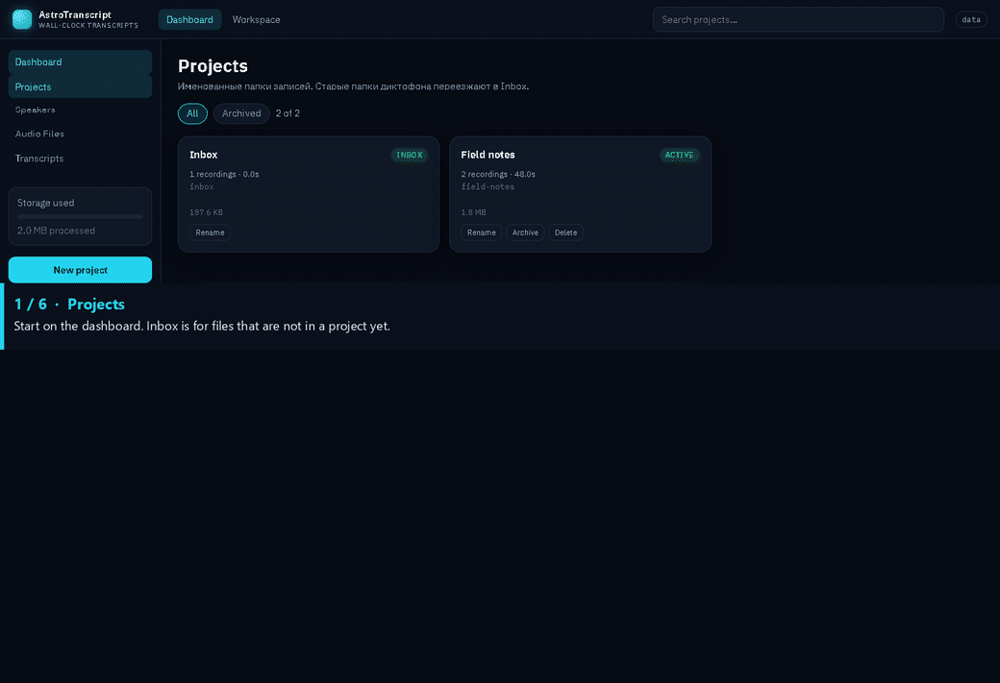

# AstroTranscript

AstroTranscript is a local web app for dictaphone recordings. It detects speech, transcribes it, and places every line on the clock time encoded in the filename.

A file named `2026.01.15.093000.wav` started at 15 January 2026, 09:30:00. A line 12 seconds into that file is shown at 09:30:12, not at `00:00:12`. The name “Astro” means that absolute clock. The app does not compute sidereal time or observatory coordinates.

The server stores audio and transcripts on your machine. Nothing is uploaded by the application itself.

## Features

- Projects that group recordings, with upload, import, rename, comment, archive, and delete.
- An Inbox project for recordings that are not filed yet.
- A zoomable timeline with the full file and the speech regions.
- Wall-clock calibration. Copy an offset from one recording and paste that same offset onto others whose names contain a start time.
- Timeline markers. Click the marker strip to add one, drag it to move it, Shift-click to name it, and double-click or right-click to remove it. `M` drops a marker at the playhead. Alt+Left and Alt+Right move between markers.
- A transcript table, plus SRT, plain text, and speech-only MP3 export.
- A speaker library and per-speaker listening settings.
- Listening effects that do not rewrite the stored file: EQ, a fixed de-echo comb, a compressor, speech leveling, and an adaptive filter. The adaptive filter runs after the other listening effects and before the output limiter.
- A mini player that keeps the current recording playing when you leave its page.

The interface is mostly Russian.

## Interface



The tour above is the real interface with a synthetic recording, `2026.01.15.093000`. Annotated stills of each screen are in [docs/guide.md](docs/guide.md).

## Requirements

- Python 3.10 or newer
- ffmpeg on `PATH`, or the `ASTRO_FFMPEG` environment variable pointing at the ffmpeg executable
- A current desktop browser (the listening effects use Web Audio)
- For transcription: the Python packages in `backend/requirements.txt`, including faster-whisper. The first transcription downloads the Whisper model.

## Install

On Windows, from this directory:

```bat
astro.cmd install
```

That creates `.venv` and installs `backend\requirements.txt`. The same steps by hand:

```bat
python -m venv .venv
.venv\Scripts\activate
python -m pip install -r backend\requirements.txt
```

On macOS or Linux, activate the virtual environment with `source .venv/bin/activate` and then install the same requirements file.

## Run

On Windows, `astro.cmd` starts the server in the background and can stop it, restart it, and show whether it is healthy:

```bat
astro.cmd start
astro.cmd status
astro.cmd stop
astro.cmd restart
astro.cmd logs
astro.cmd open
astro.cmd console
```

`astro.cmd console` runs in the current window, the same way `start.bat` does. `start.bat` uses the `data` folder in this directory when `ASTRO_DATA_ROOT` is not already set.

To pin Python or the data folder on one machine, create `astro.local.ps1` next to the script. That file is gitignored.

```powershell
$AstroPython = "C:\Path\python.exe"
$AstroDataRoot = "D:\recordings"
```

```bat
start.bat
```

Or start the server yourself:

```bat
set ASTRO_DATA_ROOT=D:\recordings
set PYTHONPATH=%CD%
python -m uvicorn backend.app.main:app --host 127.0.0.1 --port 8787
```

```bash
export ASTRO_DATA_ROOT="$PWD/data"
export PYTHONPATH="$PWD"
python -m uvicorn backend.app.main:app --host 127.0.0.1 --port 8787
```

Open http://127.0.0.1:8787

The server listens on localhost only.

## Data

`ASTRO_DATA_ROOT` is the only place recordings are stored. If it is unset, the server uses a `data` directory in the current working directory.

```
data/
  inbox/
    2026.01.15.093000/
      recording.json
      original.wav
      speech_map.json
      transcript.txt
      clips/
```

Each project is a folder. Each recording is a child folder. The folder name is the stable id. The display title and the comment live in `recording.json` and can be edited without renaming the folder.

Filename stamps the app understands:

- `YYYY.MM.DD.HHMMSS`, for example `2026.01.15.093000`
- A dictaphone stem such as `R20260115-093000`

## Processing

Open a recording and start processing from the workspace. The job decodes audio, reduces noise, finds speech, and transcribes the speech regions. The default speech model is `large-v3` on CPU, language Russian. Override it when you start the server:

```bat
set ASTRO_WHISPER_MODEL=small
set ASTRO_WHISPER_DEVICE=cpu
```

ffmpeg must be available before processing or before the app builds a waveform for a long file.

## Tests

```bat
set PYTHONPATH=%CD%
python -m pytest backend\tests -q
```

## What this repository does not contain

Recordings, chat exports, logs, and local machine paths are not part of this source tree. Keep them outside the repository. `data/` is listed in `.gitignore`.

Day-to-day use of the workspace, clock, markers, and listening effects is described in [docs/usage.md](docs/usage.md).
