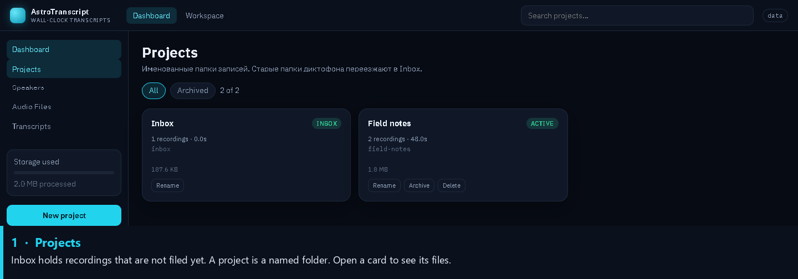
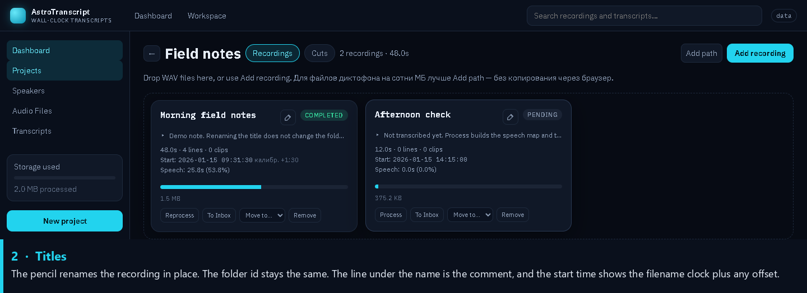
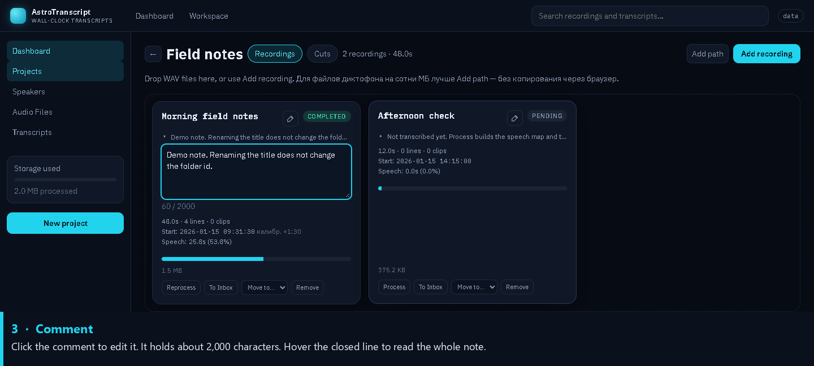
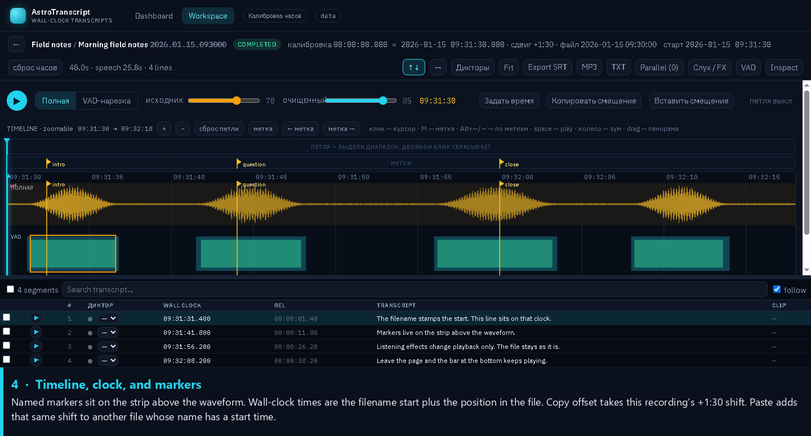
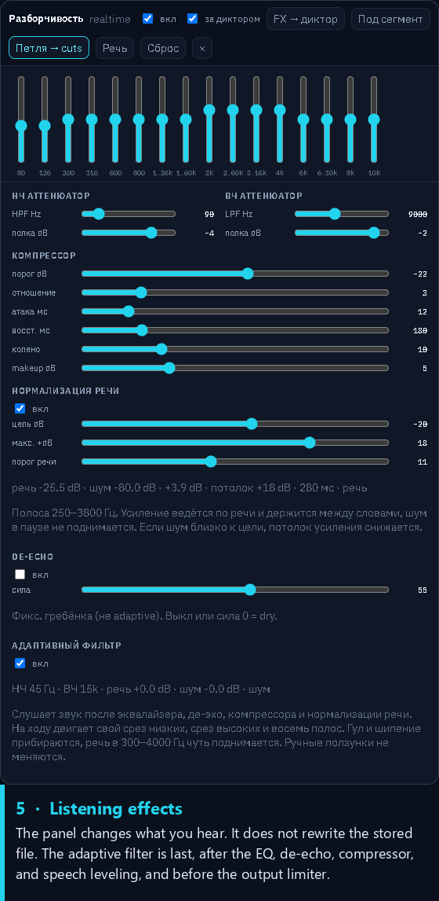
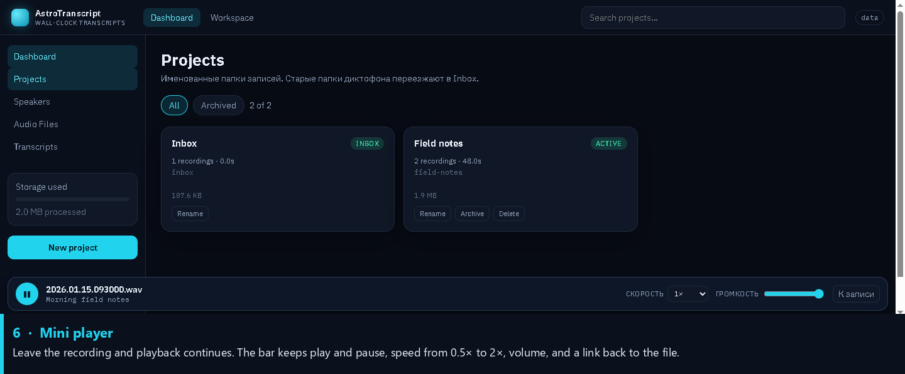

# Interface guide

The pictures below are the real interface. The recording in them is synthetic: folder id `2026.01.15.093000`, title “Morning field notes”. The filename says the file started at 09:30:00, and the clock is shifted by +1:30, so transcript lines are stamped from 09:31:30. Nothing in the pictures is a personal recording.

The interface itself is in Russian. The notes under each picture are in English.

## Tour

## Projects

Inbox is created for you and holds recordings that are not in another project. Each other card is a project folder. Rename, archive, and delete are on the card. Deleting a project moves its recordings to Inbox, so delete the recordings first when you want them gone.

## Titles and comments

The pencil edits the display title in place. A title may be up to 200 characters. Clearing it shows the folder id again. The folder id does not change when you rename the recording.

The line under the title is the comment. Click it to edit. It holds about 2,000 characters. Hover the closed line to read the whole note. The start time on the card is the filename clock plus any offset you have applied.

## Timeline, clock, and markers

The timeline has the full file and the speech regions. Click it to move the cursor. The space bar starts and pauses playback. The wheel zooms, and dragging pans.

If the filename contains a start time, every transcript time is that start plus the position in the file. “Задать время” sets which timeline position matches which clock time, and the same correction shifts the whole recording.

“Копировать смещение” copies the difference between the filename start and the corrected start. On this demo that difference is +1:30. “Вставить смещение” adds that difference to the filename start of the recording you paste onto. It does not copy the absolute clock time. A recording whose name has no timestamp cannot take an offset. An offset of zero clears the calibration.

The thin strip under the loop ruler is the marker track.

- Click empty space on the strip to add a marker.
- Drag a marker to move it.
- Shift-click a marker to name it. Names are up to 80 characters.
- Double-click or right-click a marker to delete it.
- “метка”, or the M key, drops a marker at the playhead.
- “← метка”, “метка →”, Alt+Left, and Alt+Right jump between markers.

A jump moves the cursor. Audio follows only when that recording is already playing.

## Listening effects

“Слух / FX” opens this panel. The effects change what you hear. They do not replace the stored audio, and the adaptive filter does not move the manual sliders.

The chain is the graphic EQ and shelves, a fixed de-echo comb, the compressor and makeup gain, speech leveling in the 250–3800 Hz band, then the adaptive filter, then a limiter. The adaptive filter tries to keep speech in the 300–4000 Hz range easy to hear and to turn down steady rumble and hiss.

Reset turns speech leveling and the adaptive filter off. The “Речь” preset turns them back on.

## Mini player

Playback uses one shared session. Leaving the workspace does not stop it. The bar shows the file name and the title, play and pause, speed from 0.5× to 2×, volume, and a link back to the recording.

Starting a short preview of one transcript line pauses this session. Scrubbing a recording that is not the one currently playing does not take over the session.

The same screens are described, without pictures, in [Using AstroTranscript](usage.md).
